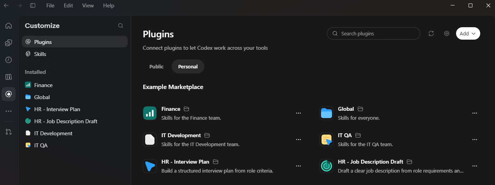
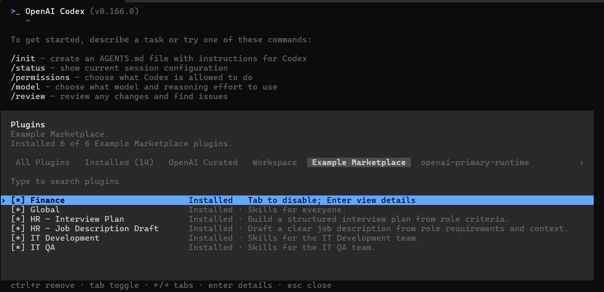

# ChatGPTMarketplace-Example

An example Codex plugin marketplace. It packages skills four different ways, so you can compare the layouts and pick and choose useful features of each.

## Tour

Click a stop to open it. For a folder, GitHub shows its README below the file list. Every stop ends with links to the previous stop, the next stop, and this tour.

| Stop | Page | What it shows |
|---|---|---|
| Preview | [Showcase](#showcase) | The marketplace running in the ChatGPT desktop app and the Codex CLI. |
| Install | [INSTALL.md](INSTALL.md) | How to add the marketplace and install, browse, or uninstall plugins. |
| 1 | [Global](plugins/Global) | The basic layout: one plugin, a few skills, available to everyone. |
| 2 | [Finance](plugins/Finance) | Assets: icons for the plugin and each skill, plus a template a skill fills in. |
| 3 | [IT](plugins/IT) | Teams within one department, each with its own plugin. |
| 3a | [IT › Development_Team](plugins/IT/Development_Team) | One team's plugin. |
| 3b | [IT › QA_Team](plugins/IT/QA_Team) | A second team's plugin in the same department. |
| 4 | [HR](plugins/HR) | One plugin per skill, so people install skills individually. |
| 4a | [HR › hr-interview-plan](plugins/HR/skills/hr-interview-plan) | A plugin containing a single skill. |
| 4b | [HR › hr-job-description](plugins/HR/skills/hr-job-description) | A second single-skill plugin. |
| Maintain | [MAINTAIN.md](MAINTAIN.md) | How to add, change, and remove plugins and skills, and how the marketplace file works. |

**[Begin with the Showcase ›](#showcase)**

### The Four Layouts Compared

| | [Global](plugins/Global) | [Finance](plugins/Finance) | [IT](plugins/IT) | [HR](plugins/HR) |
|---|---|---|---|---|
| Plugins in the folder | 1 | 1 | 1 per team | 1 per skill |
| Marketplace entries | `global` | `finance` | `it-development`, `it-qa` | `hr-interview-plan`, `hr-job-description` |
| Installing one entry gives you | Every Global skill | Every Finance skill, with icons and templates | One team's skills | One skill |

## Showcase

All six plugins from this marketplace, installed in the ChatGPT desktop app and in the Codex CLI.

**ChatGPT desktop app:** the Plugins page, Personal tab.

**Codex CLI:** the `/plugins` browser, Example Marketplace tab.

To set it up yourself, follow [INSTALL.md](INSTALL.md).

[Tour home](#tour) · **[Next: Install ›](INSTALL.md)**

## Tour Complete

You've seen all four layouts. To choose one for a new group of skills:

- **Everyone needs the same skills:** use the [Global](plugins/Global) layout.
- **You want icons or templates:** add assets as [Finance](plugins/Finance) does. This works with any layout.
- **A department has distinct teams:** give each team its own plugin, as [IT](plugins/IT) does.
- **People need to pick individual skills:** make each skill its own plugin, as [HR](plugins/HR) does.

Then add it to the marketplace by following [MAINTAIN.md](MAINTAIN.md).

[‹ Previous: Maintain](MAINTAIN.md) · [Tour home](#tour)
